<p align="center">
  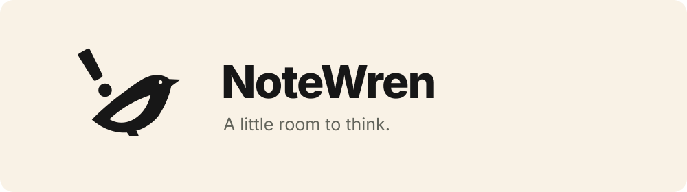
</p>

# NoteWren

Free, open-source, local-first Markdown notes with branching and optional self-hosted sync.

NoteWren is being built around five ideas:

- **Free and open source.** MIT-licensed, so you can use, inspect and customise it.
- **Local-first writing.** Keep writing offline, with notes stored on your device.
- **Note branching.** Explore another version while keeping the original.
- **Your data, your sync server.** Keep your library local or sync through a server you control. Hosting may have its own costs.
- **One library across your devices.** Each device keeps a local database; sync exchanges changes so your notes and branches travel with you.

macOS, Windows and Omarchy are the initial desktop targets, with iOS and Android clients planned.

## Development status

The repository contains the interactive web reference and a native macOS Tauri app backed by a Rust SQLite core. The local sync server is available for self-hosted development. There is no signed installable release.

[Mockups](#mockups) · [Branches](#branches) · [Quick start](#run-locally) · [Local sync server](#local-sync-server) · [Contributing](#contributing) · [Licence](#licence)

## Mockups

Screenshots of the interactive web reference. Window controls and device frames are illustrative, not native builds. The Apple fold layout is a concept, not a hardware specification.

Each thumbnail links to the full-size image. Cmd-click on macOS or Ctrl-click on Windows and Linux opens it in a new tab. Omarchy follows the selected OS palette, shown here in Flexoki Light and Tokyo Night.

[Open the complete light-and-dark gallery](docs/images/platforms-light-dark.png).

| Light | Dark |
| :---: | :---: |
| **macOS**<br>[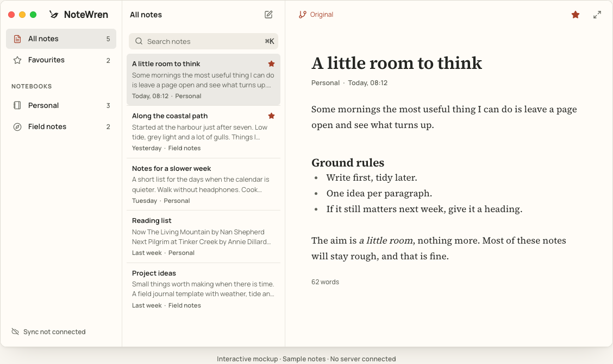](docs/images/macos-light.png) | **macOS**<br>[](docs/images/macos-dark.png) |
| **Windows 11**<br>[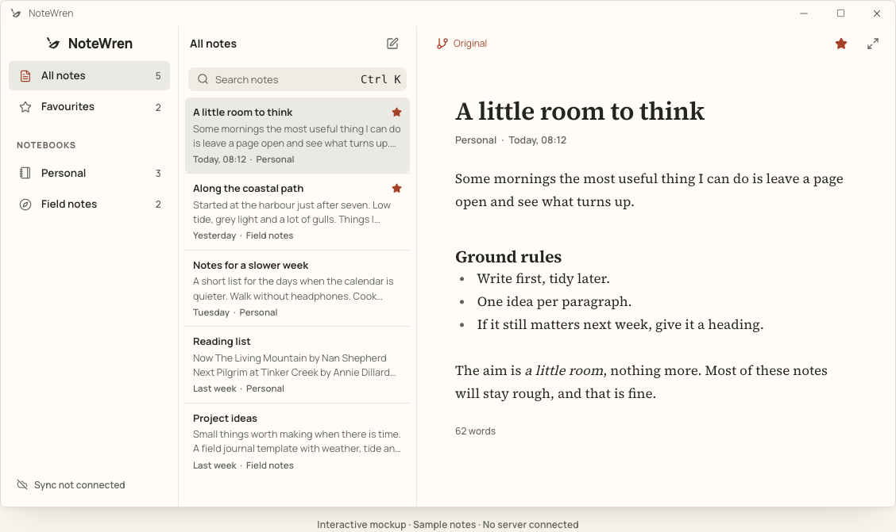](docs/images/windows-light.png) | **Windows 11**<br>[](docs/images/windows-dark.png) |
| **Omarchy · Flexoki Light**<br>[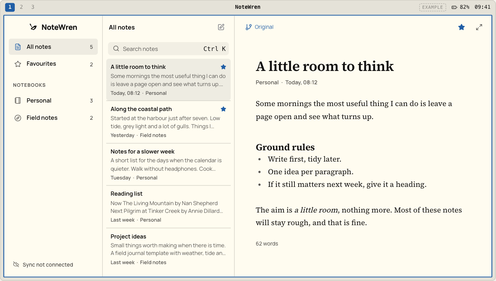](docs/images/omarchy-light.png) | **Omarchy · Tokyo Night**<br>[](docs/images/omarchy.png) |
| **iPhone**<br>[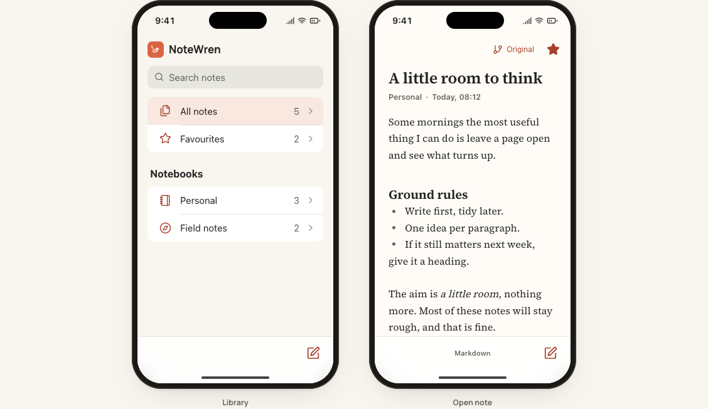](docs/images/iphone-light.png) | **iPhone**<br>[](docs/images/iphone.png) |
| **Android**<br>[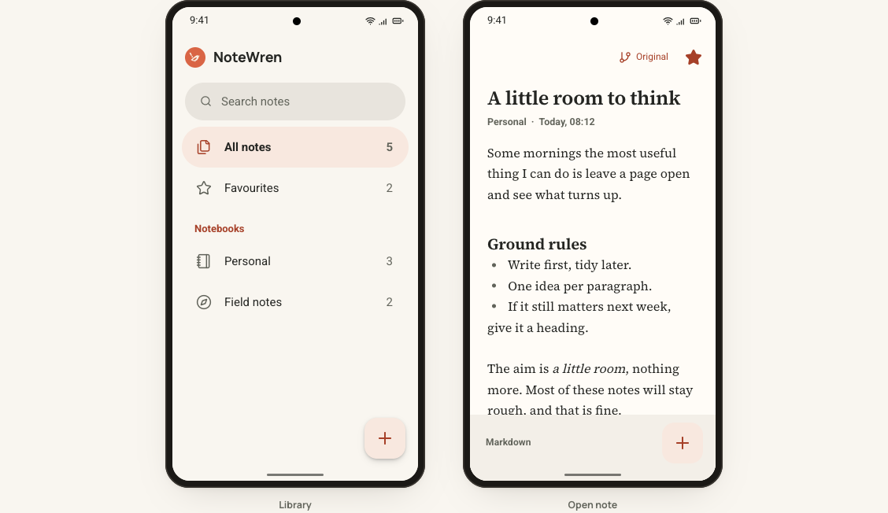](docs/images/android-light.png) | **Android**<br>[](docs/images/android.png) |
| **iPhone Fold concept**<br>[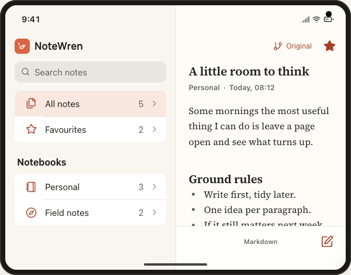](docs/images/apple-fold-light.png) | **iPhone Fold concept**<br>[](docs/images/apple-fold.png) |
| **Android fold**<br>[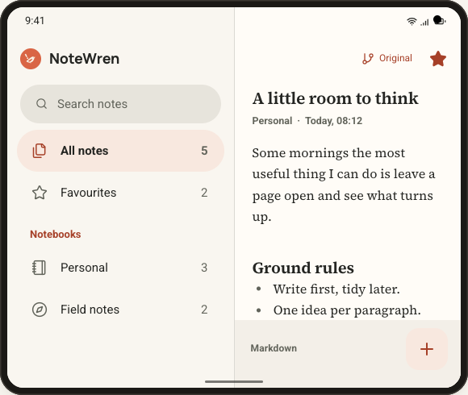](docs/images/android-fold-light.png) | **Android fold**<br>[](docs/images/android-fold.png) |
| **Surface Duo**<br>[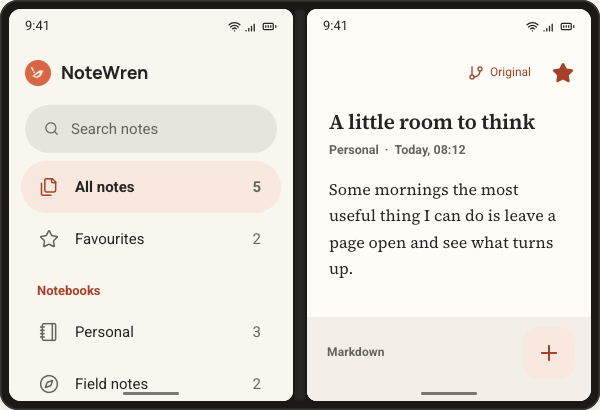](docs/images/surface-duo-light.png) | **Surface Duo**<br>[](docs/images/surface-duo.png) |

## Branches

Keep a draft while trying another direction. Branch a note for a different opening, a shorter version or an agent's suggested rewrite, then inspect the alternatives before choosing where to continue writing. The Git-like graph shows where each branch began. Branches remain independent, with no merge action.

Open the graph from the branch name in the editor toolbar. Selecting a branch inspects it without changing where you write. Continue writing makes that branch current and returns to the editor. New branch copies the inspected branch's title and Markdown into a separate draft.

Compare with defaults to the saved fork point. That snapshot stays fixed even if the parent is edited later. You can also compare against another branch's current content. Rename a branch as its purpose changes, archive it to keep it for reference, or restore it to continue writing. Deletion requires confirmation and is limited to branches with no children; the original and current writing branches are protected.

The graph replaces the desktop editor and fills the note pane on mobile. It follows light and dark mode and the selected Omarchy OS palette.

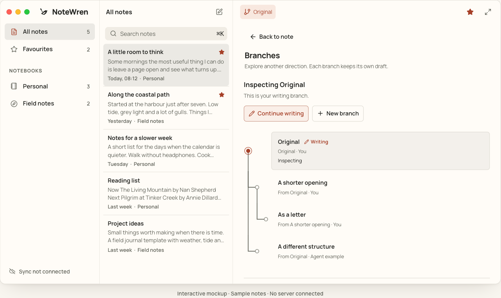

<details>
<summary>Branches on mobile</summary>

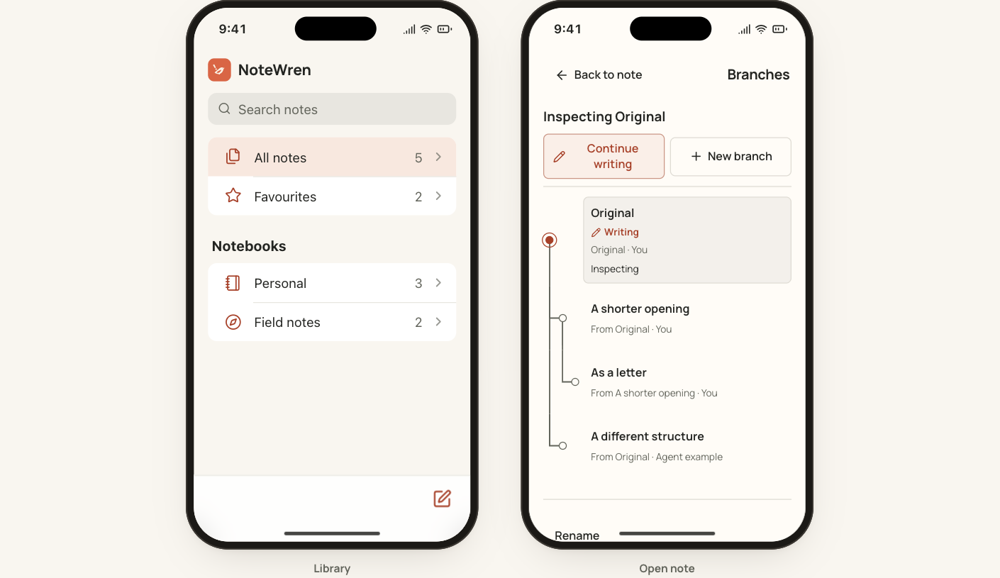

</details>

The web reference models branches of individual notes in memory. The native app persists notes, revisions and branches locally. Try the seeded branches in the first sample note or the live example under Components to see the reference behaviour. Agent-labelled reference branches are sample content; they do not run an agent. Notebook-wide branching and isolated agent work through the CLI or MCP interface remain planned.

## Local sync server

The repository now includes a local-first Rust core, a SQLite-backed sync library and a self-hosted HTTP sync server. The server keeps library data on disk and authenticates its administrative provisioning endpoint and per-library pull/push endpoints with bearer tokens. It listens on `127.0.0.1:8787` by default.

Run the server with an administrator token:

```sh
export NOTEWREN_SERVER_ADMIN_TOKEN='replace-with-a-long-random-token'
cargo run --locked -p notewren-server
```

The server stores data in `./notewren-server-data`. Set `NOTEWREN_SERVER_BIND`, `NOTEWREN_SERVER_DATA_DIR` and `NOTEWREN_SERVER_MAX_BODY_BYTES`, or use the matching command-line options. Library tokens must be 32–512 printable ASCII bytes and are stored as hashes.

The HTTP API provisions a library at `POST /v1/libraries`, then synchronises it with `POST /v1/sync/pull` and `POST /v1/sync/push`. The server tests exercise provisioning, authentication, idempotent pushes, pulls and two-client convergence.

Provision a library, keeping the returned library token private:

```sh
export NOTEWREN_SERVER_ADMIN_TOKEN='replace-with-a-long-random-token'
export NOTEWREN_LIBRARY_TOKEN='another-long-random-token-at-least-32-bytes'
curl -sS -X POST http://127.0.0.1:8787/v1/libraries \
  -H "Authorization: Bearer $NOTEWREN_SERVER_ADMIN_TOKEN" \
  -H 'Content-Type: application/json' \
  -d "{\"library_id\":\"$(uuidgen | tr '[:upper:]' '[:lower:]')\",\"token\":\"$NOTEWREN_LIBRARY_TOKEN\"}"
```

The response contains `library_id`. Configure that ID, the server URL and the library token in each native app instance under Settings, then use Sync. Each instance has its own `NOTEWREN_DATA_DIR` when you are testing two clients on one Mac. Pull and push requests use the library bearer token.

Concurrent edits use a conservative three-way merge. Clean disjoint edits are combined. Overlapping edits are preserved as separate branches with their ancestry and receipts retained.

The hosted deployment and CLI/MCP interfaces remain outside this build.

### Planned agent access

The CLI and Model Context Protocol (MCP) interface will share the app's Rust core and local library. Agents will be able to search, read, create and edit notes without requiring the sync server.

The intended packaging is one CLI/MCP executable included with the desktop app and also available as a standalone install for headless machines. MCP registration with an agent client will be opt-in. NoteWren will provide tools to an existing agent, rather than bundle a model or agent runtime. These interfaces are not implemented yet.

Agent edits are planned to stay in a separate, named branch for the user to inspect. Choosing to continue writing there must be explicit. Note and notebook branching are part of the intended product; the current mockups cover only individual notes, and notebook-wide transactions are not implemented.

## Preview

The reference has four sections:

- **Platform mockups:** macOS, Windows, Omarchy and mobile. The mobile view offers iPhone and Android phones and open iPhone Fold, Android fold and Surface Duo frames. On wide screens the phone library and editor appear side by side; folds always show both. On narrow screens, opening a note transitions to the editor. The Omarchy frame offers Tokyo Night and Flexoki Light.
- **Foundations:** light and dark themes, semantic colour tokens, typography, spacing and shape.
- **Components:** a live branch graph and writing example, buttons, validation, switches, loading feedback, empty states and document-state examples.
- **Identity & assets:** the geometric wren, real transparent wing and eye cutouts, actual-size previews and SVG downloads.

The mockups support searching sample notes, notebook and favourite filters, creating drafts, editing titles and Markdown text, and desktop focus mode. Use Command K or Control K to focus desktop search. Escape leaves focus mode when focus is inside the mockup.

The web reference uses sample content held in memory. Moving between notes keeps edits within that reference session. Switching platforms, leaving the mockups section or reloading resets them. There is no authentication, disk storage or network synchronisation in the reference. The body is a CodeMirror Markdown editor that formats as you type; there is no toolbar. Mobile options adapt the frame around a shared web interface; they are not native iOS or Android builds.

## Run locally

Built and exercised with Node 24.9, npm 10.8 and Rust on macOS.

To run the design reference:

```sh
npm install --no-audit --no-fund
npm run dev -- --port 5187 --strictPort
```

Open `http://127.0.0.1:5187/`.

For the native macOS app:

```sh
npm --workspace apps/desktop run tauri:dev
npm --workspace apps/desktop run tauri:build
```

Selecting a note opens it for editing immediately. The toolbar has a square-and-pencil `New note` action, with `Branches` and `History` as secondary views and `Back to note` to return. `New branch` starts an explicit branch from the current editor, and inspecting a branch does not switch the writing branch until `Switch to this branch` is chosen. The note-row context menu contains note actions without leaving the editor. The macOS shell uses the webview for its controls and a native overlay title bar with system traffic lights, while the application surface uses compact system typography and neutral macOS-style tones.

The macOS sidebar heading sits below the traffic lights. The packaged icon uses an Icon Composer asset with glass, shadow and specular effects disabled, preserving the flat wren artwork on macOS Tahoe. Its source is in `apps/desktop/src-tauri/icons/NoteWren.icon`; compiled assets are checked in under `icons/macos`, so normal builds do not require Icon Composer.

After changing the icon source, regenerate the compiled assets with Xcode 26 or later, then rebuild the app:

```sh
xcrun actool apps/desktop/src-tauri/icons/NoteWren.icon \
  --compile apps/desktop/src-tauri/icons/macos \
  --platform macosx --minimum-deployment-target 11.0 \
  --app-icon NoteWren \
  --output-partial-info-plist /tmp/notewren-icon-partial.plist
npm --workspace apps/desktop run tauri:build
```

If bundling fails with `xattr: option -r not recognised`, a non-system `xattr` is taking precedence. Build with `PATH="/usr/bin:/bin:/usr/sbin:/sbin:$PATH" npm --workspace apps/desktop run tauri:build` to use Apple's version.

For an isolated native smoke run:

```sh
NOTEWREN_DATA_DIR=/tmp/notewren-native-smoke \
  target/release/notewren-desktop
```

The timestamped History view uses persisted revision timestamps where available. Older rows with no stored timestamp are labelled without an invented date.

The bundled app can also be launched with:

```sh
open target/release/bundle/macos/NoteWren.app
```

The native app reads the same local library and sync settings as the packaged binary.

For the local sync server, configure the URL, library ID and token in Settings on each native instance. Give each instance a distinct `NOTEWREN_DATA_DIR` when testing two clients on one Mac, then use Sync in both windows.


For workspace checks:

```sh
npm run typecheck
npm run build
cargo test --workspace --locked
```

Set `NOTEWREN_DATA_DIR` to isolate a native smoke run from your normal local library.

The build runs TypeScript checking before Vite. The preview serves `dist/` at `http://127.0.0.1:5188/`.

## Use the system

- `src/tokens.css`: identity primitives and semantic light/dark roles. Set `data-theme="dark"` on the document root for dark mode.
- `src/components/ui.tsx`: reusable `Button`, `Badge`, `Field` and `Switch` primitives.
- `src/components/Logo.tsx`: the decorative, current-colour SVG component. Its `size` is the height in pixels; `variant` is `negative` or `filled`.
- `src/components/PlatformMockups.tsx`: shared sample-note state and platform presentations.
- `src/components/BranchGraph.tsx`: the shared per-note branch graph, `NoteBranch` type and standalone `BranchGraphExample`.
- `src/styles.css`: the reference layout and primitive styles.
- `src/components/mockups.css`: platform-specific presentation.
- `public/brand/`: standalone SVG symbols and app icons. The six colour variants and two app icons have download links in the reference. Two current-colour versions are also available for embedding.
- `PRODUCT.md`: agreed product scope and brand commitments.
- `DESIGN.md`: visual rules extracted from this implementation.
- `.impeccable/design.json`: component examples and design metadata.

Brand terracotta is `#D96545`. Light-theme action buttons use the deeper `#A64028` with white text. This separates the identity colour from the contrast needed for controls. Source Serif 4 is used for writing, while Manrope carries the interface and wordmark. Fonts are bundled locally, with no external font request.

## Verification

The design reference has been exercised in Chromium across editing, search, branches, focus mode, mobile layouts, both themes and 360, 768 and 1440 CSS-pixel widths. SVG raster sampling confirmed transparent eye and wing pixels in the cutout versions and opaque wing pixels in the filled versions.

The Rust workspace has been exercised with `cargo test --workspace --locked`: 37 tests passed across 9 suites. The native macOS app was packaged successfully at `target/release/bundle/macos/NoteWren.app`; interactive native smoke is performed separately with macOS System Events.

The local sync server's HTTP tests cover provisioning, bearer-token rejection, pull, push, idempotent receipts and two-client convergence. A hosted deployment, iOS and Android runtimes, and CLI/MCP access remain unimplemented.

The Impeccable source scan reported advisory typography values in the branch graph and existing platform chrome. The earlier HTML scan could not run because the installed scanner raised `TypeError: modules.selectAll is not a function`; that check was not treated as a pass.

## Contributing

Bug reports, design feedback and contributions are welcome through [GitHub issues](https://github.com/danieljohnmorris/notewren/issues) and pull requests.

- For bugs, include reproduction steps, browser, viewport, platform preview and a screenshot where relevant.
- Discuss storage, sync and native-shell changes in an issue before starting implementation.
- Keep changes focused, follow the existing TypeScript, Rust and CSS conventions, and run the workspace checks above.
- For interface changes, exercise the affected preview in light and dark modes and include screenshots in the pull request.

See [PRODUCT.md](PRODUCT.md) for scope and [DESIGN.md](DESIGN.md) for the interface rules.

## Licence

The project code and supplied vector assets are released under MIT. Manrope and Source Serif 4 retain their SIL Open Font Licences, included in `public/licences/`. Dependencies retain their own licences. Product name and trademark clearance remain open.
