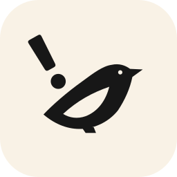
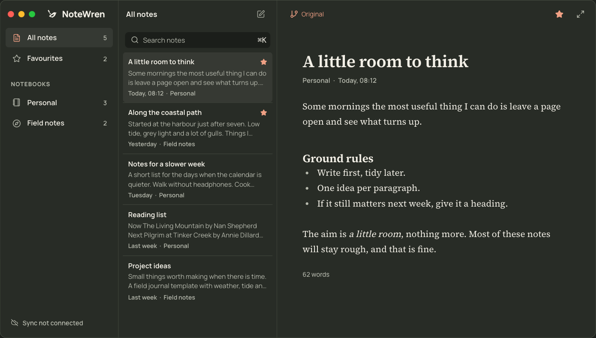
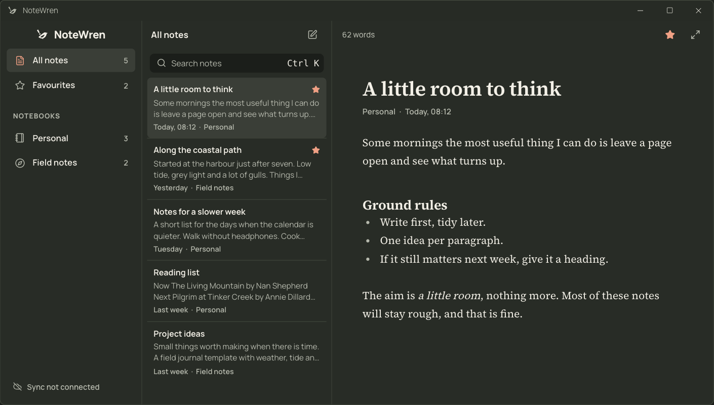
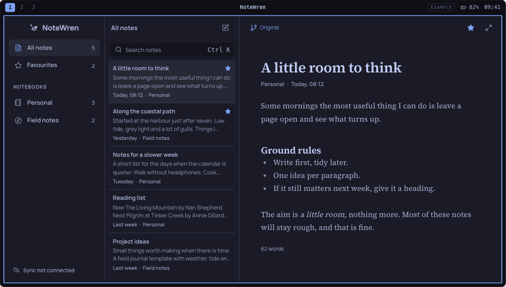
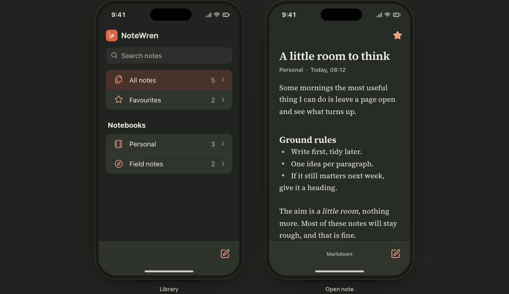
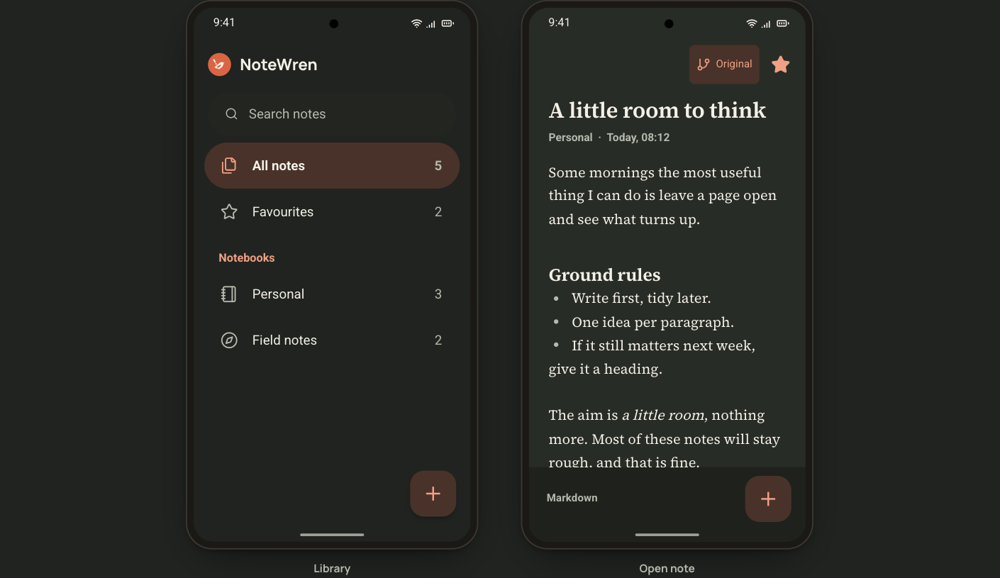
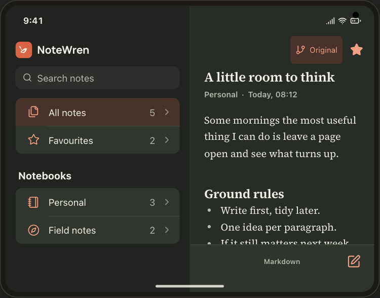
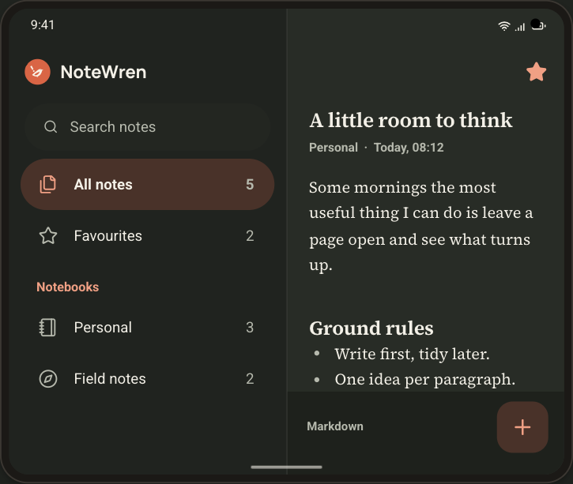
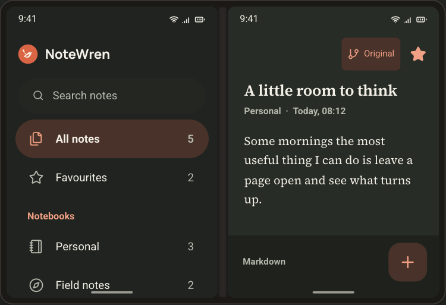
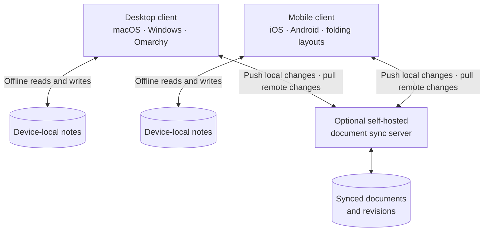

<p align="center">
  
</p>

# NoteWren

An open-source, local-first Markdown notes app with optional self-hosted sync.

NoteWren is being built for macOS, Windows and Omarchy, with iOS and Android clients planned. The aim is one portable notes library, offline writing and a sync server you can run yourself.

## Development status

The repository currently contains the interactive interface, Markdown editor and visual assets. The native Tauri app, persistent local storage and sync server are not implemented yet. There is no installable app release.

[Mockups](#mockups) · [Quick start](#run-locally) · [Planned sync](#planned-sync) · [Contributing](#contributing) · [Licence](#licence)

## Mockups

Screenshots of the interactive web reference. Window controls and device frames are illustrative, not native builds. The Apple fold layout is a concept, not a hardware specification.

### Desktop

**macOS**



<details>
<summary>Windows 11 and Omarchy</summary>

**Windows 11**



**Omarchy**



</details>

### iOS and Android

**iPhone**



<details>
<summary>Android and folding devices</summary>

**Android**



**Apple fold concept**



**Android fold**



**Surface Duo**



</details>

## Planned sync

The intended design is local-first: each device keeps its own local store for offline writing. An optional self-hosted document server exchanges changes between devices. This is the proposed architecture; storage, transport, authentication and conflict handling are not implemented.



Sync must preserve both versions of conflicting edits. Devices must never share a live SQLite database file. The sync protocol and server implementation remain to be chosen.

## Preview

The reference has four sections:

- **Platform mockups:** macOS, Windows, Omarchy and mobile. The mobile view offers iPhone and Android phones and open iPhone Fold, Android fold and Surface Duo frames. On wide screens the phone library and editor appear side by side; folds always show both. On narrow screens, opening a note transitions to the editor. The Omarchy frame has a picker that applies seven Omarchy palettes.
- **Foundations:** light and dark themes, semantic colour tokens, typography, spacing and shape.
- **Components:** buttons, validation, switches, loading feedback, empty states and document-state examples.
- **Identity & assets:** the geometric wren, real transparent wing and eye cutouts, actual-size previews and SVG downloads.

The mockups support searching sample notes, notebook and favourite filters, creating drafts, editing titles and Markdown text, and desktop focus mode. Use Command K or Control K to focus desktop search. Escape leaves focus mode when focus is inside the mockup.

All notes are sample content held in memory. Moving between notes keeps edits within that mockup. Switching platforms, leaving the mockups section or reloading resets them. There is no authentication, disk storage or network synchronisation. The body is a CodeMirror Markdown editor that formats as you type; there is no toolbar. Mobile options adapt the frame around a shared web interface; they are not native iOS or Android builds.

## Run locally

Built and exercised with Node 24.9 and npm 10.8.

```sh
npm install --no-audit --no-fund
npm run dev -- --port 5187 --strictPort
```

Open `http://127.0.0.1:5187/`.

For the production build and local preview:

```sh
npm run build
npm run preview -- --port 5188 --strictPort
```

The build runs TypeScript checking before Vite. The preview serves `dist/` at `http://127.0.0.1:5188/`.

## Use the system

- `src/tokens.css`: identity primitives and semantic light/dark roles. Set `data-theme="dark"` on the document root for dark mode.
- `src/components/ui.tsx`: reusable `Button`, `Badge`, `Field` and `Switch` primitives.
- `src/components/Logo.tsx`: the decorative, current-colour SVG component. Its `size` is the height in pixels; `variant` is `negative` or `filled`.
- `src/components/PlatformMockups.tsx`: shared sample-note state and platform presentations.
- `src/styles.css`: the reference layout and primitive styles.
- `src/components/mockups.css`: platform-specific presentation.
- `public/brand/`: standalone SVG symbols and app icons. The six colour variants and two app icons have download links in the reference. Two current-colour versions are also available for embedding.
- `PRODUCT.md`: agreed product scope and brand commitments.
- `DESIGN.md`: visual rules extracted from this implementation.
- `.impeccable/design.json`: component examples and design metadata.

Brand terracotta is `#D96545`. Light-theme action buttons use the deeper `#A64028` with white text. This separates the identity colour from the contrast needed for controls. Source Serif 4 is used for writing, while Manrope carries the interface and wordmark. Fonts are bundled locally, with no external font request.

## Verification

The production build was exercised in Chromium. Browser checks covered desktop note editing and navigation, search and empty results, favourite counts, draft creation, focus mode and keyboard shortcuts, mobile library/editor transitions, component validation and feedback, and both themes. All four sections had no document-level horizontal overflow at 360, 768 and 1440 CSS pixels.

SVG raster sampling confirmed transparent eye and wing pixels in the cutout versions and opaque wing pixels in the filled versions. Native macOS, Linux, iOS and Android runtimes have not been exercised.

The Impeccable source scanner returned no findings for `src/`. Its HTML scan could not run because the installed scanner raised `TypeError: modules.selectAll is not a function`. That check was not treated as a pass.

## Contributing

Bug reports, design feedback and contributions are welcome through [GitHub issues](https://github.com/danieljohnmorris/notewren/issues) and pull requests.

- For bugs, include reproduction steps, browser, viewport, platform preview and a screenshot where relevant.
- Discuss storage, sync and native-shell changes in an issue before starting implementation.
- Keep changes focused, follow the existing TypeScript and CSS conventions, and run `npm run build`.
- For interface changes, exercise the affected preview in light and dark modes and include screenshots in the pull request.

See [PRODUCT.md](PRODUCT.md) for scope and [DESIGN.md](DESIGN.md) for the interface rules. Native clients and the sync server are planned work, with no release dates committed.

## Licence

The project code and supplied vector assets are released under MIT. Manrope and Source Serif 4 retain their SIL Open Font Licences, included in `public/licences/`. Dependencies retain their own licences. Product name and trademark clearance remain open.
