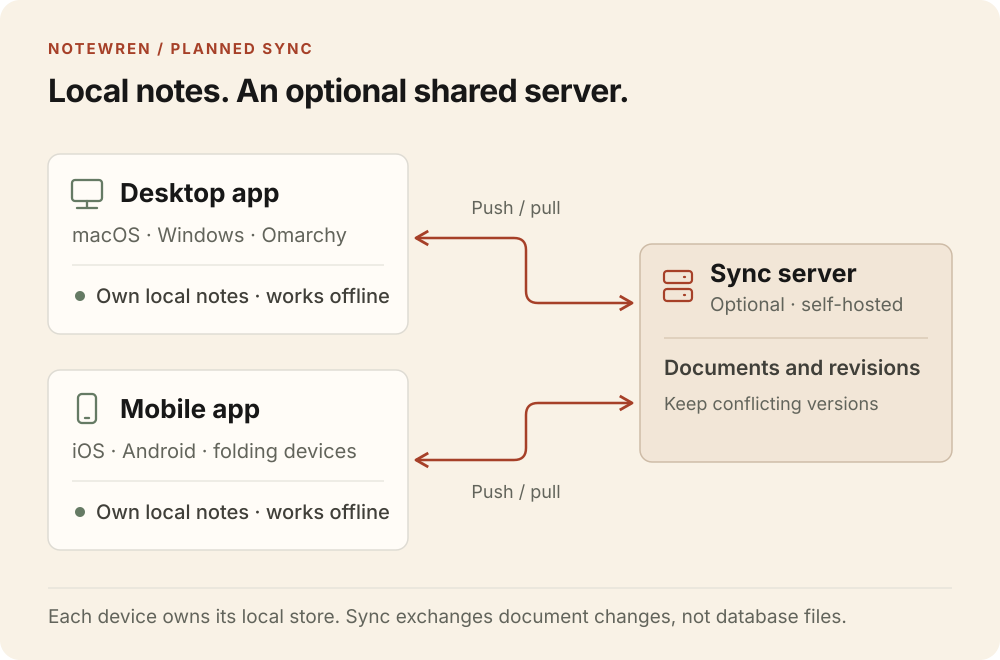

<p align="center">
  
</p>

# NoteWren

An open-source, local-first Markdown notes app with optional self-hosted sync.

NoteWren is being built for macOS, Windows and Omarchy, with iOS and Android clients planned. The aim is one portable notes library, offline writing and a sync server you can run yourself.

## Development status

The repository currently contains the interactive interface, Markdown editor and visual assets. The native Tauri app, persistent local storage and sync server are not implemented yet. There is no installable app release.

[Mockups](#mockups) · [Branches](#branches) · [Quick start](#run-locally) · [Planned sync](#planned-sync) · [Contributing](#contributing) · [Licence](#licence)

## Mockups

Screenshots of the interactive web reference. Window controls and device frames are illustrative, not native builds. The Apple fold layout is a concept, not a hardware specification.

Each thumbnail links to the full-size image. Cmd-click on macOS or Ctrl-click on Windows and Linux opens it in a new tab. Omarchy follows the selected OS palette, shown here in Flexoki Light and Tokyo Night.

[Open the complete light-and-dark gallery](docs/images/platforms-light-dark.png).

| Light | Dark |
| :---: | :---: |
| **macOS**<br>[](docs/images/macos-light.png) | **macOS**<br>[](docs/images/macos-dark.png) |
| **Windows 11**<br>[](docs/images/windows-light.png) | **Windows 11**<br>[](docs/images/windows-dark.png) |
| **Omarchy · Flexoki Light**<br>[](docs/images/omarchy-light.png) | **Omarchy · Tokyo Night**<br>[](docs/images/omarchy.png) |
| **iPhone**<br>[](docs/images/iphone-light.png) | **iPhone**<br>[](docs/images/iphone.png) |
| **Android**<br>[](docs/images/android-light.png) | **Android**<br>[](docs/images/android.png) |
| **iPhone Fold concept**<br>[](docs/images/apple-fold-light.png) | **iPhone Fold concept**<br>[](docs/images/apple-fold.png) |
| **Android fold**<br>[](docs/images/android-fold-light.png) | **Android fold**<br>[](docs/images/android-fold.png) |
| **Surface Duo**<br>[](docs/images/surface-duo-light.png) | **Surface Duo**<br>[](docs/images/surface-duo.png) |

## Branches

Keep a draft while trying another direction. Branch a note for a different opening, a shorter version or an agent's suggested rewrite, then inspect the alternatives before choosing where to continue writing. The Git-like graph shows where each branch began. Branches remain independent, with no merge action.

Open the graph from the branch name in the editor toolbar. Selecting a branch inspects it without changing where you write. Continue writing makes that branch current and returns to the editor. New branch copies the inspected branch's title and Markdown into a separate draft.

Compare with defaults to the saved fork point. That snapshot stays fixed even if the parent is edited later. You can also compare against another branch's current content. Rename a branch as its purpose changes, archive it to keep it for reference, or restore it to continue writing. Deletion requires confirmation and is limited to branches with no children; the original and current writing branches are protected.

The graph replaces the desktop editor and fills the note pane on mobile. It follows light and dark mode and the selected Omarchy OS palette.


<details>
<summary>Branches on mobile</summary>


</details>

The current reference models branches of individual notes in memory. Try the seeded branches in the first sample note or the live example under Components. Changes reset when the preview is unmounted or the page reloads. Agent-labelled branches are sample content; they do not run an agent. Notebook-wide branching and isolated agent work through the CLI or MCP interface are planned, alongside persistent local storage.

## Planned sync

Proposed architecture. Local storage and the sync service are not implemented yet.



The sync protocol, authentication and server implementation remain to be chosen.

### Deploying your own server

One-click deployment is planned. Candidates include Vercel or Netlify for the sync API with Neon providing Postgres storage, subject to the chosen sync protocol and hosting limits. A Docker deployment is also intended for a VPS or home server. No hosting provider or database has been selected yet.

The setup flow should provision storage, configure authentication and return a server URL to connect your devices. Credentials belong in the host's secret settings, never in a deploy-button URL. Deployment buttons and templates will be added when the backend can be deployed and checked end to end; none are available yet.

### Planned agent access

The CLI and Model Context Protocol (MCP) interface will share the app's Rust core and local library. Agents will be able to search, read, create and edit notes without requiring the sync server.

The intended packaging is one CLI/MCP executable included with the desktop app and also available as a standalone install for headless machines. MCP registration with an agent client will be opt-in. NoteWren will provide tools to an existing agent, rather than bundle a model or agent runtime. These interfaces are not implemented yet.

Agent edits are planned to stay in a separate, named branch for the user to inspect. Choosing to continue writing there must be explicit. Note and notebook branching are part of the intended product; the current mockups cover only individual notes, and notebook-wide transactions are not implemented.

## Preview

The reference has four sections:

- **Platform mockups:** macOS, Windows, Omarchy and mobile. The mobile view offers iPhone and Android phones and open iPhone Fold, Android fold and Surface Duo frames. On wide screens the phone library and editor appear side by side; folds always show both. On narrow screens, opening a note transitions to the editor. The Omarchy frame offers Tokyo Night and Flexoki Light.
- **Foundations:** light and dark themes, semantic colour tokens, typography, spacing and shape.
- **Components:** a live branch graph and writing example, buttons, validation, switches, loading feedback, empty states and document-state examples.
- **Identity & assets:** the geometric wren, real transparent wing and eye cutouts, actual-size previews and SVG downloads.

The mockups support searching sample notes, notebook and favourite filters, creating drafts, editing titles and Markdown text, and desktop focus mode. Use Command K or Control K to focus desktop search. Escape leaves focus mode when focus is inside the mockup.

All notes are sample content held in memory. Moving between notes keeps edits within that mockup. Switching platforms, leaving the mockups section or reloading resets them. There is no authentication, disk storage or network synchronisation. The body is a CodeMirror Markdown editor that formats as you type; there is no toolbar. Mobile options adapt the frame around a shared web interface; they are not native iOS or Android builds.

## Run locally

Built and exercised with Node 24.9 and npm 10.8.

```sh
npm install --no-audit --no-fund
npm run dev -- --port 5187 --strictPort
```

Open `http://127.0.0.1:5187/`.

For the production build and local preview:

```sh
npm run build
npm run preview -- --port 5188 --strictPort
```

The build runs TypeScript checking before Vite. The preview serves `dist/` at `http://127.0.0.1:5188/`.

## Use the system

- `src/tokens.css`: identity primitives and semantic light/dark roles. Set `data-theme="dark"` on the document root for dark mode.
- `src/components/ui.tsx`: reusable `Button`, `Badge`, `Field` and `Switch` primitives.
- `src/components/Logo.tsx`: the decorative, current-colour SVG component. Its `size` is the height in pixels; `variant` is `negative` or `filled`.
- `src/components/PlatformMockups.tsx`: shared sample-note state and platform presentations.
- `src/components/BranchGraph.tsx`: the shared per-note branch graph, `NoteBranch` type and standalone `BranchGraphExample`.
- `src/styles.css`: the reference layout and primitive styles.
- `src/components/mockups.css`: platform-specific presentation.
- `public/brand/`: standalone SVG symbols and app icons. The six colour variants and two app icons have download links in the reference. Two current-colour versions are also available for embedding.
- `PRODUCT.md`: agreed product scope and brand commitments.
- `DESIGN.md`: visual rules extracted from this implementation.
- `.impeccable/design.json`: component examples and design metadata.

Brand terracotta is `#D96545`. Light-theme action buttons use the deeper `#A64028` with white text. This separates the identity colour from the contrast needed for controls. Source Serif 4 is used for writing, while Manrope carries the interface and wordmark. Fonts are bundled locally, with no external font request.

## Verification

The branch preview was exercised in the production build in Chromium. Checks covered independent title and body edits, nested branches, duplicate-name validation, renaming, archive/restore, protected deletion, confirmation and Escape navigation. A fork-point comparison stayed unchanged after its parent was edited; selecting that parent as the comparison showed its current content. Phone checks covered creating a branch, editing it and switching back. The Components example had no horizontal overflow at 360, 768 and 1440 CSS pixels.

The production build was exercised in Chromium. Browser checks covered desktop note editing and navigation, search and empty results, favourite counts, draft creation, focus mode and keyboard shortcuts, mobile library/editor transitions, component validation and feedback, and both themes. All four sections had no document-level horizontal overflow at 360, 768 and 1440 CSS pixels.

SVG raster sampling confirmed transparent eye and wing pixels in the cutout versions and opaque wing pixels in the filled versions. Native macOS, Linux, iOS and Android runtimes have not been exercised.

The Impeccable source scan reported advisory typography values in the branch graph and existing platform-chrome colour, radius and typography values. The graph's compact type sizes are documented in `DESIGN.md`. The earlier HTML scan could not run because the installed scanner raised `TypeError: modules.selectAll is not a function`; that check was not treated as a pass.

## Contributing

Bug reports, design feedback and contributions are welcome through [GitHub issues](https://github.com/danieljohnmorris/notewren/issues) and pull requests.

- For bugs, include reproduction steps, browser, viewport, platform preview and a screenshot where relevant.
- Discuss storage, sync and native-shell changes in an issue before starting implementation.
- Keep changes focused, follow the existing TypeScript and CSS conventions, and run `npm run build`.
- For interface changes, exercise the affected preview in light and dark modes and include screenshots in the pull request.

See [PRODUCT.md](PRODUCT.md) for scope and [DESIGN.md](DESIGN.md) for the interface rules. Native clients and the sync server are planned work, with no release dates committed.

## Licence

The project code and supplied vector assets are released under MIT. Manrope and Source Serif 4 retain their SIL Open Font Licences, included in `public/licences/`. Dependencies retain their own licences. Product name and trademark clearance remain open.
